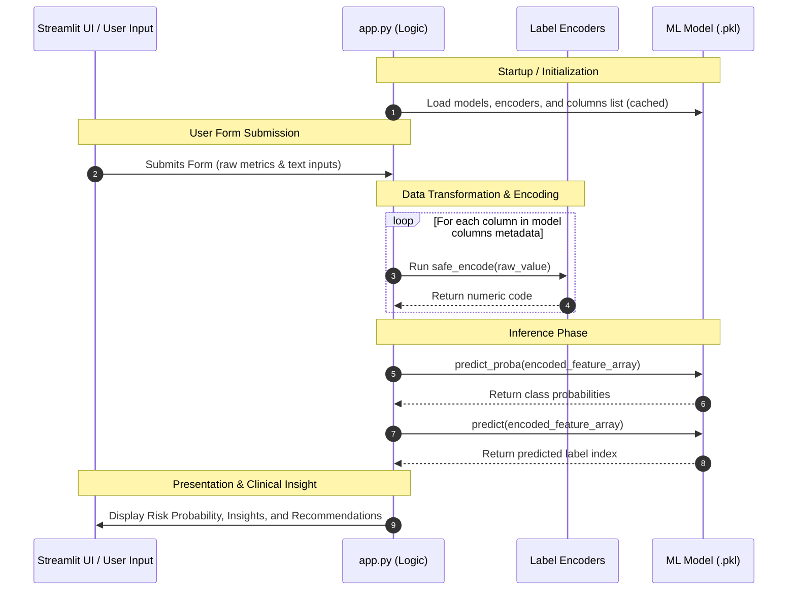

# Soulplanet Machine Learning Integration & Deployment Guide

This document provides a detailed, easy-to-understand explanation of how the machine learning models are used inside the **Soulplanet Health & Wellness Portal** and walks you through deploying the project to a public environment.

---

## Part 1: How the Models Work (The Simple View) 🩺

### The Clinic Analogy
Imagine the Streamlit web app (`app.py`) is a **modern diagnostics clinic**:
* **The Clinician (User)**: Fills out a patient's questionnaire on screen.
* **The Models (AI Doctors)**: Two expert doctors (Cardiology and Diabetes) sitting in a back office. They **only speak in numbers**. They don't understand words like `"Male"`, `"Yes"`, or `"High stress"`.
* **The Encoders & Columns (Translators)**: A front-desk translator that converts words to numbers, orders them correctly, and hands them to the doctors.

### The Three Key Model Files
Under the `models/` directory, each model has three crucial files:
1. **The Model (`*_model.pkl`)**: The "trained brain". This is the actual classifier (Random Forest or XGBoost) that learned patient patterns during training.
2. **The Columns List (`*_columns.pkl`)**: The exact order of questions the model expects (e.g. `[Age, Gender, BMI...]`).
3. **The Encoders (`*_encoders.pkl`)**: A lookup list that maps textual answers to numbers (e.g., `"Yes" ➔ 1`, `"No" ➔ 0`).

---

### Step-by-Step Execution Lifecycle in the Code



#### Step 1: Loading the Models (Startup)
When the app runs, it loads the model files. To prevent the site from slowing down on every click, it caches them using Streamlit's `@st.cache_resource` decorator so they remain loaded in memory.
```python
# Cached function to load models and encoders once
@st.cache_resource
def load_models_and_encoders():
    # ... Reads pickle files ...
```

#### Step 2: Collecting Inputs
The clinician interacts with sliders, dropdowns, and number inputs. Categorical values (like gender) are read dynamically from the loaded encoder classes to prevent mismatched options.

#### Step 3: Translating Words to Numbers (Safe Encoding)
If a user selects `"Yes"` for smoking, the custom function `safe_encode()` checks the loaded encoders dictionary. It transforms `"Yes"` to `1` or `"No"` to `0`. If a user inputs something unexpected, the function falls back to a default value (like `0`) instead of crashing the application.

#### Step 4: Arranging the Data in Order
The model is strict about feature ordering. We loop through the list of column names (`heart_cols` or `diabetes_cols`) and compile a list of translated numbers:
```python
encoded_vals = [45, 1, 122, 195, 0, 1, ...] # Age=45, Male=1, SBP=122...
```
We convert this to a 2D array: `[[45, 1, 122, 195, ...]]`.

#### Step 5: Getting Predictions
We feed the array to the model using two functions:
* **`.predict()`**: Outputs the predicted classification index (e.g. `1` for `"Yes, high risk"`).
* **`.predict_proba()`**: Outputs the probability list (e.g. `[0.15, 0.85]`, meaning `85%` chance of high risk).

#### Step 6: Presentation & Recommendations
The app decodes the prediction to display a red alert card (for High Risk) or a green card (for Low Risk). It then reads the user's raw answers and automatically suggests lifestyle changes (e.g. recommending smoking cessation if the user smokes).

---

## Part 2: Deployment Guide 🚀

Yes, you can easily deploy this Streamlit project online for free! Below are the guides for deploying to **Hugging Face Spaces** (Recommended) and **Streamlit Community Cloud**.

---

### Option A: Deploying to Hugging Face Spaces (Recommended)

Hugging Face Spaces is a free, cloud-hosting platform that supports Streamlit applications natively.

#### Step 1: Create a Hugging Face Account & Space
1. Go to [Hugging Face](https://huggingface.co/) and create a free account.
2. Click on **Spaces** in the top navigation, and then click **Create new Space**.
3. Fill in the details:
   * **Space Name**: e.g., `soulplanet-health-portal`
   * **License**: Open source license (e.g., `mit`)
   * **SDK**: Select **Streamlit**
   * **Hardware**: Choose **Blank Space / CPU Basic** (This is free and more than enough for these models)
   * **Visibility**: Public (or Private if you want to restrict access)
4. Click **Create Space**.

#### Step 2: Clone the Space Repository to Your Local Machine
Hugging Face Spaces use Git repositories. Clone your new Space locally:
```bash
git clone https://huggingface.co/spaces/YOUR_USERNAME/YOUR_SPACE_NAME
```

#### Step 3: Add Your Project Files
Copy the contents of your `Health-Care-Domain/` directory into your cloned Space folder. Make sure the structure looks like this:
```text
YOUR_SPACE_NAME/
├── app.py
├── home.py
├── requirements.txt
├── models/
│   ├── heart_disease_model.pkl
│   ├── heart_disease_encoders.pkl
│   ├── heart_disease_columns.pkl
│   ├── diabetes_model.pkl
│   ├── diabetes_encoders.pkl
│   └── diabetes_columns.pkl
└── README.md
```

#### Step 4: Track Large Model Files with Git LFS (Critical)
The cardiovascular model `heart_disease_model.pkl` is about 20MB. While Git can push small files, Hugging Face recommends tracking files larger than 10MB using **Git LFS (Large File Storage)** to ensure quick and successful pushes.

1. Install Git LFS on your machine if you haven't:
   ```bash
   git lfs install
   ```
2. In your space folder, tell Git LFS to track `.pkl` files:
   ```bash
   git lfs track "*.pkl"
   git add .gitattributes
   ```

#### Step 5: Commit and Push Your Code
Now, commit your files and push them to Hugging Face:
```bash
git add .
git commit -m "Initial commit with model assets and UI code"
git push origin main
```
*Note: If prompted for credentials, use your Hugging Face username and your Hugging Face **Access Token** as the password (you can generate this token in your Hugging Face Account Settings under Access Tokens).*

#### Step 6: Watch It Build
Once pushed, go to your Space page on Hugging Face. You will see the status change to **Building**. Hugging Face will automatically:
1. Scan `requirements.txt` and install `streamlit`, `pandas`, `numpy`, `scikit-learn`, and `xgboost`.
2. Locate `app.py` and run it.
3. Switch status to **Running** and display your live web application!

---

### Option B: Deploying to Streamlit Community Cloud

Streamlit Community Cloud is another free platform that deploys apps directly from a GitHub repository.

#### Step 1: Push Your Code to GitHub
1. Create a repository on GitHub (e.g. `heart-diabetes-diagnostics`).
2. Push your `Health-Care-Domain` directory contents to that repository.

#### Step 2: Connect to Streamlit Cloud
1. Visit [Streamlit Share](https://share.streamlit.io/) and log in with your GitHub account.
2. Click **New app**.
3. Choose your repository:
   * **Repository**: `YOUR_GITHUB_USERNAME/YOUR_REPO_NAME`
   * **Branch**: `main` (or `master`)
   * **Main file path**: `app.py`
4. Click **Deploy**.

Streamlit will provision a container, install dependencies from your `requirements.txt`, and deploy the application. It will provide you with a shareable URL (e.g. `https://your-app.streamlit.app/`).
